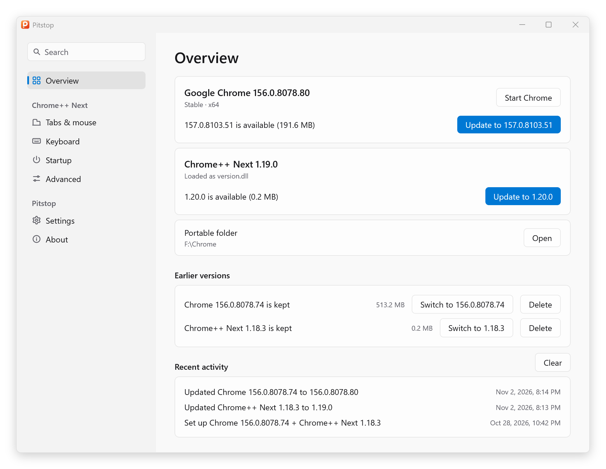
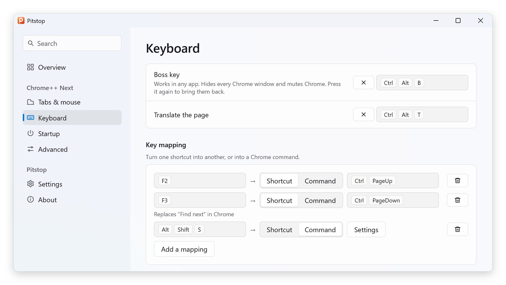
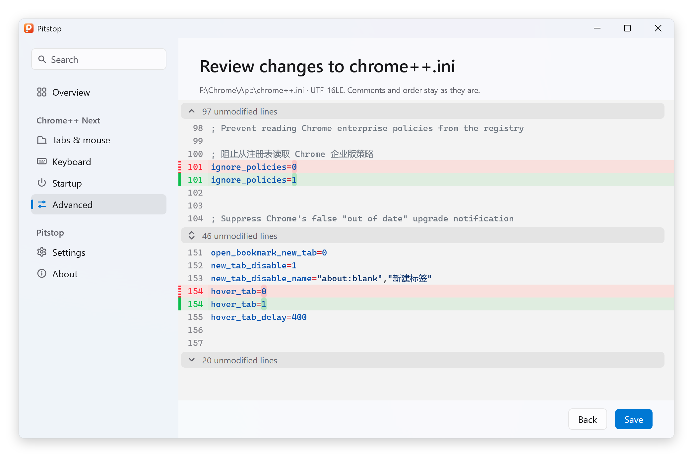

  

<h1 align="center">Pitstop</h1>

  Set up, update and configure portable Chrome on Windows.

  <a href="https://github.com/Bush2021/pitstop/releases/latest">Download</a> ·
  <a href="README.zh-CN.md">简体中文</a>

Pitstop sets up portable Google Chrome for use with [Chrome++ Next](https://github.com/Bush2021/chrome_plus), keeps both up to date, and configures `chrome++.ini` interactively. Its native UI is written with [MyGo](https://github.com/egoist/mygo) and keeps memory and CPU use low. It comes in English and Simplified Chinese, with light and dark themes.

<picture>
  <source media="(prefers-color-scheme: dark)" srcset="assets/screenshots/overview-en-dark.png">
  
</picture>

## Features

### Setup and updates

- Sets up Chrome and Chrome++ Next for several architectures.
- Takes over an existing portable Chrome when placed next to its `App` folder.
- Updates Chrome and Chrome++ Next manually or automatically in the background.
- Can keep earlier versions and their data.
- Supports differential Chrome updates.
- Lets you choose which Google server Chrome downloads from first, and rotates through the servers when retrying.
- Gets small xz packages for Chrome over Omaha protocol 4, decoding them as they download and resuming interrupted downloads.

### Configuration

<picture>
  <source media="(prefers-color-scheme: dark)" srcset="assets/screenshots/keyboard-en-dark.png">
  
</picture>

- Edits Chrome++ Next's options interactively.
- Searches settings by English or Chinese name, or by key.
- Records shortcuts as you press them.
- Picks common Chrome commands and command-line switches from built-in lists.
- Moves the profile folder together with its data.
- Shows the changed lines before saving, and warns when another program has changed the file.
- Saves to `chrome++.ini` without changing its comments, key order or encoding, and backs up each save.

<picture>
  <source media="(prefers-color-scheme: dark)" srcset="assets/screenshots/review-en-dark.png">
  
</picture>

## Download and use

1. Download the latest release for your system: [x64](https://github.com/Bush2021/pitstop/releases/latest/download/pitstop-x64.zip), [x86](https://github.com/Bush2021/pitstop/releases/latest/download/pitstop-x86.zip) or [ARM64](https://github.com/Bush2021/pitstop/releases/latest/download/pitstop-arm64.zip). All versions are on [Releases](https://github.com/Bush2021/pitstop/releases). Don't rename the extracted `pitstop.exe`, since self-update relies on that name to replace it.
2. Put it in the folder for Chrome. For an existing portable Chrome, put it next to the `App` folder.
3. Run Pitstop, select a channel, architecture and update mode, then select **Set up**.

## Notes

- Requires Windows 10 or later.
- Avoid putting it in a drive root.
- Background updates need Chrome++ Next 1.19.0 or later. When they're on, Pitstop sets `managed_updates=1` in `chrome++.ini` and adds its own command to `launch_on_startup`, so it starts in the background with Chrome, without a service or scheduled task. Switching back to **Only when I check** undoes both and leaves your own `launch_on_startup` commands alone.
- In automatic mode, Pitstop updates itself on unmetered connections.
- Pitstop won't update a `chrome.exe` patched by [setdll](https://github.com/Bush2021/setdll). Chrome++ Next works with Chrome directly, so setdll isn't needed.
- `pitstop.exe` is not code-signed, and releases are built by GitHub Actions. Security software may warn on first run; use your own judgment.

## License

[GPL-3.0-or-later](LICENSE)
