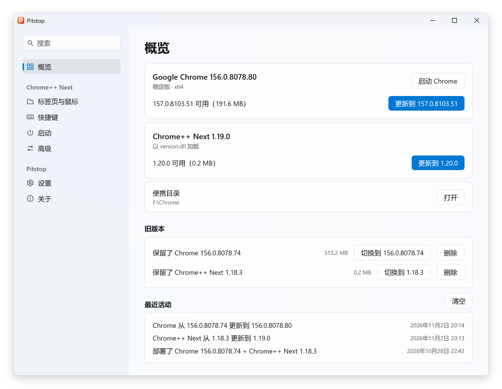
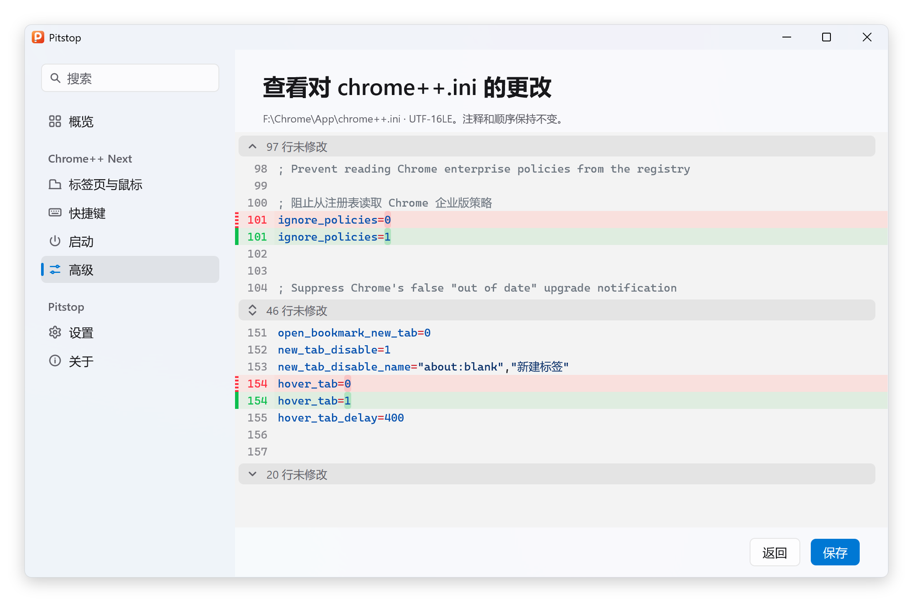

  

<h1 align="center">Pitstop</h1>

  在 Windows 上部署、更新和配置便携版 Chrome。

  <a href="https://github.com/Bush2021/pitstop/releases/latest">下载</a> ·
  <a href="README.md">English</a>

Pitstop 用来部署配合 [Chrome++ Next](https://github.com/Bush2021/chrome_plus) 使用的便携版 Google Chrome，负责两者的更新，并提供可交互式的配置 `chrome++.ini`。基于 [MyGo](https://github.com/egoist/mygo) 编写原生 UI，注重低内存和 CPU 使用率，提供简体中文和英文界面，支持浅色和深色主题。

<picture>
  <source media="(prefers-color-scheme: dark)" srcset="assets/screenshots/overview-zh-CN-dark.png">
  
</picture>

## 功能

### 部署与更新

- 部署多种架构的 Chrome 和 Chrome++ Next。
- 当放在已有便携版 Chrome 的 `App` 文件夹旁时，可以直接接管。
- 支持手动或后台自动更新 Chrome 和 Chrome++ Next。
- 支持保留旧版本及其数据。
- 支持启用 Chrome 差分更新。
- 支持选择优先从哪个 Google 服务器下载 Chrome 和轮换重试。
- Chrome 更新使用 Omaha 协议 4 获取小体积 xz 安装包，支持边下载边解压和断点续传。

### 配置

<picture>
  <source media="(prefers-color-scheme: dark)" srcset="assets/screenshots/keyboard-zh-CN-dark.png">
  
</picture>

- 交互式修改 Chrome++ Next 的选项。
- 支持按中文名、英文名或键名搜索设置项。
- 支持直接录制快捷键。
- 支持从内置列表中选择常用 Chrome 命令和命令行开关。
- 支持连同数据一起移动用户数据文件夹。
- 支持查看保存前改动的行，文件被其他程序改过时会提醒。
- 保存到 `chrome++.ini` 时保留原有注释、顺序和编码，每次保存都会备份。

<picture>
  <source media="(prefers-color-scheme: dark)" srcset="assets/screenshots/review-zh-CN-dark.png">
  
</picture>

## 下载与使用

1. 下载对应系统的最新版：[x64](https://github.com/Bush2021/pitstop/releases/latest/download/pitstop-x64.zip)、[x86](https://github.com/Bush2021/pitstop/releases/latest/download/pitstop-x86.zip) 或 [ARM64](https://github.com/Bush2021/pitstop/releases/latest/download/pitstop-arm64.zip)，历史版本见 [Releases](https://github.com/Bush2021/pitstop/releases)。请勿改名解压出的 `pitstop.exe`，因为 Pitstop 的自更新需要依靠这个文件名来替换程序。
2. 将程序放入 Chrome 所在的文件夹。已有便携版 Chrome 时，与 `App` 文件夹放在同一级。
3. 运行 Pitstop，选择渠道、架构和更新方式后，点击 **部署**。

## 说明

- 需要 Windows 10 或更新版本。
- 请避免直接放在盘符根目录。
- 后台更新需要 Chrome++ Next 1.19.0 或更新版本。开启后台更新时，Pitstop 会把 `chrome++.ini` 中的 `managed_updates` 设为 1，并在 `launch_on_startup` 中加入自己的启动命令，用于随 Chrome 在后台启动 Pitstop，不需要服务或计划任务。改回 **仅在我检查时** 会撤销这两处改动，`launch_on_startup` 中你自己的命令不受影响。
- 自动模式下，Pitstop 会在不按流量计费的网络下更新自身。
- 被 [setdll](https://github.com/Bush2021/setdll) 修改过的 `chrome.exe` 不会被更新。Chrome++ Next 原生适配 Chrome，因此不需要使用 setdll。
- `pitstop.exe` 没有代码签名，发布的程序由 GitHub Actions 构建，首次运行时安全软件可能会提示，请自行判断。

## 许可证

[GPL-3.0-or-later](LICENSE)
